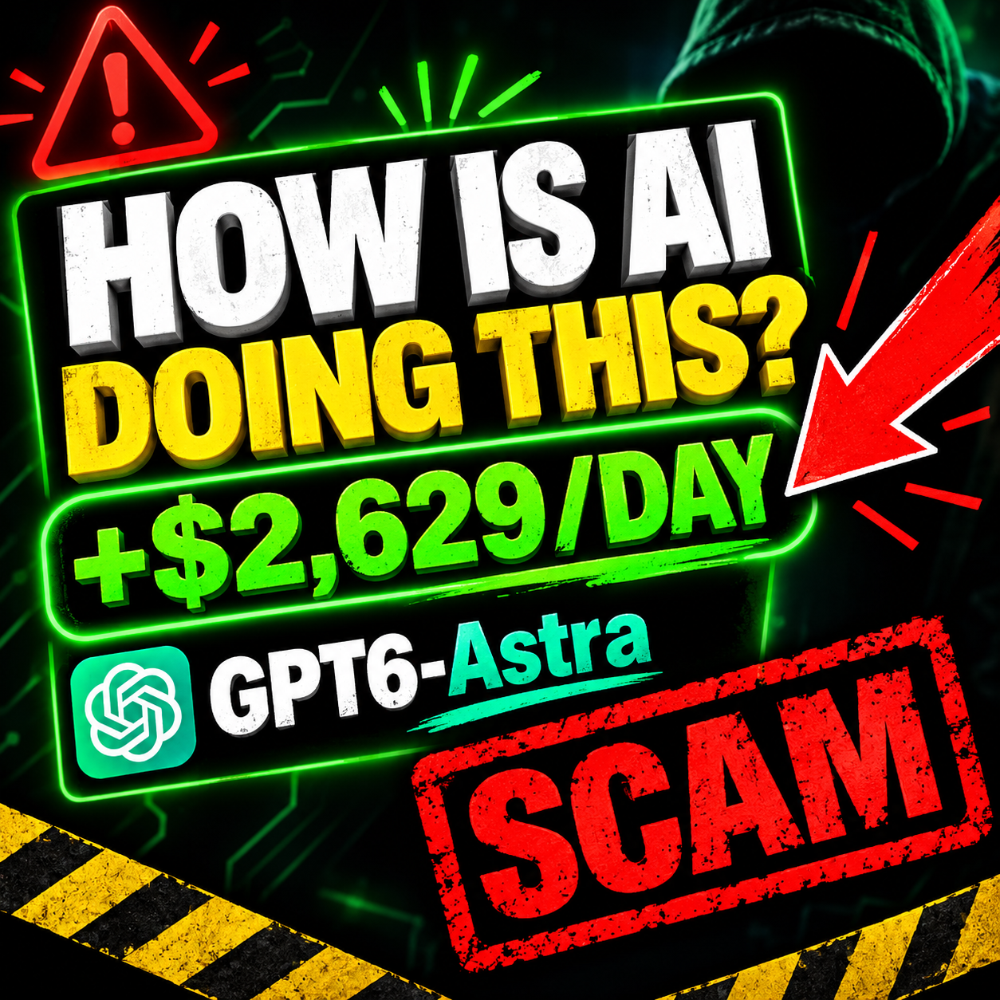

# Anatomie eines mutmaßlichen 'Flash-Loan-Arbitrage-Bot'-Betrugsmusters

[English version](README.md)

  

## Kurzfassung (TL;DR)

Dieses Repo dokumentiert die Analyse eines "Flash-Loan-Arbitrage-Bots", der in einem YouTube-Video beworben wurde. Der untersuchte Code ist unbekannter Herkunft, und ob er mit dem Contract aus dem Video übereinstimmt, ist ungeklärt. Die Code-Datei enthält behauptete Gewinnbelege, die nicht echt sein können. Ihre eigenen Tests zeigen nur deshalb Gewinn, weil sie die Preislücke selbst erzeugen. Auf einem unveränderten Mainnet-Fork hat unsere Messung keinen organischen Gewinn gefunden.

**Solchen Code nicht deployen. Kein ETH an einen Contract aus so einem Video schicken.**

## Im untersuchten Video beobachtetes Muster

Das Folgende beschreibt, was wir in dem einen untersuchten Video beobachtet haben. Es ist keine allgemeine Aussage über alle solchen Videos.

- Das Video verspricht passives Einkommen durch einen "Arbitrage-Bot".
- Zuschauer sollen einen Contract in eine Browser-IDE kopieren, selbst deployen und 1–2 ETH einzahlen.
- Außerdem sollen sie einen "Verification-Link" anklicken.
- In angepinnten Kommentaren stehen Kurzlinks. Die Kommentarspalte zeigt gleichförmig positive, allgemein gehaltene Kommentare.

Ein Flash Loan wird innerhalb einer einzigen Transaktion geliehen und zurückgezahlt. Er braucht außer Gas kein eigenes Kapital. Die Aufforderung, ETH in einen Bot einzuzahlen, der angeblich mit Flash Loans arbeitet, ist deshalb das zentrale Warnsignal dieses Musters.

## Der analysierte Code

Der analysierte Code ist eine Kopie unbekannter Herkunft. Ob er mit dem Contract aus dem Video übereinstimmt, ist ungeklärt. Der analysierte Code wird hier nicht veröffentlicht.

Die Originaldatei verlangt in ihrem Kopfkommentar "1–2 ETH oder mehr". Der Contract selbst lehnt einfache ETH-Überweisungen aber ab (receive/fallback). Ein Off-Chain-Keeper-Skript in der Originaldatei verweigert den Live-Modus, solange sein eigenes Wallet weniger als 2 ETH hält.

Eine Falle im Contract haben wir nicht gefunden. Unsere Prüfung war rein statisch (siehe unten).

## Red-Flag-Checkliste

- Garantiertes oder "stabiles tägliches" Einkommen durch einen Trading-Bot.
- Du sollst kopierten Code selbst deployen und aufladen.
- "Verification-Links", Kurzlinks oder Links in angepinnten Kommentaren.
- Viele fast identische Kommentare, die Gewinne loben.
- Eine einzige riesige Datei, die Code, "Audit"-Behauptungen, "Testergebnisse" und "DO NOT EDIT"-Banner bündelt.
- Behauptete Transaktionen und Statistiken, die beim Nachrechnen nicht stimmen.
- Gewinn gibt es nur in Tests, die vorher die Preise manipulieren.

## Befunde aus der Code-Prüfung

Die Prüfung war statisch: Wir haben den Code gelesen und durchsucht. Ausgeführt haben wir nur die unten beschriebenen Foundry-Tests.

Die Zeilennummern in diesem Abschnitt beziehen sich auf die Originaldatei, die nicht veröffentlicht ist. Diese Datei bündelte Contract, Tests, einen Off-Chain-Keeper und ein Simulationsskript, die beiden letzten als auskommentiertes JavaScript. Keeper und Simulation wurden nie ausgeführt.

**Behauptete Belege, die nicht echt sein können.** Die "echten Mainnet-Tests" und Statistiken im Kopf der Datei halten einer Prüfung nicht stand:

- Zwei verschiedene Trades haben denselben Transaktions-Hash (Zeilen 395 und 498).
- Mehrere Trade-Rechnungen ergeben einen Verlust, werden aber als Gewinn ausgewiesen. Ein Trade macht aus 100.000 USDC 100.412 USDC, nennt 1.040 USDC DEX-Gebühren und meldet trotzdem +255 USDC (Zeilen 381–393). Ein anderer macht aus 50.000 DAI 50.198 USDC, nennt 300 USDC Gebühren und meldet +133,50 USDC (Zeilen 339–351).
- Einige Swaps sind unmöglich. Der Curve-3pool soll WETH liefern (Zeile 320), enthält aber kein WETH. Es werden Routen über Curve und Balancer aufgeführt, doch der Contract kann nur Router im Stil von Uniswap V2 und V3 aufrufen.
- Eine "30-Tage"-Statistik (Zeile 501) enthält eine Gewinnserie von "34 Tagen" (Zeile 514).
- Der "Mainnet Run" (Zeile 169) ist der Mock-Modus der Simulation. Er nutzt fest eingetragene, synthetische Pool-Reserven (Zeile 3769).

**Kein Drainer gefunden, mit Einschränkungen.** Im Contract und in den Off-Chain-Skripten haben wir keine fest eingetragenen Empfängeradressen gefunden, kein `selfdestruct` oder `delegatecall` und keinen Code, der einen Private Key irgendwohin sendet. Der Flash-Loan-Callback prüft Aufrufer und Initiator.

Diese Ergebnisse beruhen nur auf Lesen. Die 16 Contract-Adressen in der Originaldatei wurden nicht gegen Etherscan geprüft.

**Nicht bestätigt.** Bei der Prüfung sind drei vermutete Funktionsfehler aufgefallen, die wir nicht getestet haben:

- der Uniswap-V3-Swap-Aufruf im Contract passt nicht zum voreingestellten V3-Router;
- die V3-Quoter-Schnittstelle im Keeper ist falsch;
- die Signatur der Flashbots-Anfragen ist fehlerhaft.

Das sind Hypothesen.

## Unser Experiment

Aufbau: Foundry-Tests auf einem Mainnet-Fork bei Block 25733035 (Details unter "So haben wir gemessen").

**Die Gewinn-Tests erzeugen ihre Gelegenheit selbst.** Die Tests PROOF1 bis PROOF3 lassen zuerst einen simulierten "Wal" (finanziert per Foundry-`vm.deal`) WETH auf Uniswap V2 verkaufen. Danach handelt der Bot gegen die Lücke, die dadurch entsteht. Die geloggten Gewinne sind die Änderung des USDC-Guthabens im Contract, gemessen nach Rückzahlung der Aave-Prämie und vor Gas:

- 3.530,15 USDC: 20.000 USDC Flash Loan, der Wal verkauft 1.000 WETH.
- 41,02 USDC: 2.000 USDC Flash Loan, der Wal verkauft 100 WETH.
- 26.848,25 USDC: 50.000 USDC Flash Loan, der Wal verkauft 5.000 WETH.

**Die "honest organic baseline" prüft nichts.** Test T4 fragt einen Rundlauf ab, enthält aber kein Assert. Eine seiner Variablen wird nie verwendet.

**Unsere eigene Messung (T4b).** Unser Test `test_T4b_organicRoundTrip` setzt keinen Wal ein und führt nichts aus. Der Test fragt nur die Router nach Quotes, deshalb fehlen Aave-Gebühr und Gas. Ein Rundlauf USDC → WETH → USDC verliert bei jedem getesteten Einsatz (auf zwei Nachkommastellen gerundet):

| Einsatz (USDC) | Uniswap → Sushi | Sushi → Uniswap |
|---:|---:|---:|
| 100 | −0,49 % | −0,88 % |
| 1.000 | −1,23 % | −1,61 % |
| 5.000 | −4,38 % | −4,75 % |
| 20.000 | −14,60 % | −14,94 % |

**Grenzen der Messung.** Sie deckt einen Block und ein Paar ab (USDC/WETH auf Uniswap V2 und SushiSwap). Sie nutzt nur Quotes, ohne Gas und ohne konkurrierende Bots. Sie ist keine Aussage über alle Märkte. Sie zeigt aber: In diesem Aufbau gab es den beworbenen Gewinn ohne künstliche Preisbewegung nicht.

## So haben wir gemessen

- Werkzeug: Foundry 1.8.5.
- Umgebung: ein lokaler Mainnet-Fork, festgelegt auf Block 25733035. Es wurden keine Transaktionen an das echte Netzwerk gesendet.
- Methode für T4b: Quotes über `getAmountsOut` der Router für den Rundlauf USDC → WETH → USDC, in beiden Router-Reihenfolgen (Uniswap V2 und SushiSwap), für Einsätze von 100, 1.000, 5.000 und 20.000 USDC. Das Ergebnis ist die Differenz zwischen ausgezahlten und eingesetzten USDC, bezogen auf den Einsatz.
- Nicht enthalten: Aave-Flash-Loan-Gebühr und Gas.

Der analysierte Code wird hier nicht veröffentlicht.

## Wenn du schon etwas deployt oder eingezahlt hast

- Token-Freigaben deines Wallets prüfen und widerrufen, zum Beispiel mit revoke.cash. Tippe die Adresse selbst in den Browser ein. Nutze nie einen Link aus einem Video oder seinen Kommentaren.
- Verbleibendes Guthaben auf ein neues Wallet verschieben. Wenn du jemals eine Seed Phrase oder einen Private Key auf einer Seite eingegeben hast, die aus so einem Video verlinkt war, behandle das alte Wallet als kompromittiert.
- Das Video bei YouTube melden.

## Über dieses Repo

Dieses Repo enthält nur diese Dokumentation, auf Englisch und Deutsch.

## Haftungshinweis

Dieses Repo dient ausschließlich Bildungs- und Forschungszwecken. Es wird ohne Mängelgewähr ("as is") und ohne jede Gewährleistung bereitgestellt. Es ist keine Finanzberatung. Es beschreibt ein einzelnes Code-Beispiel und ein mutmaßliches Betrugsmuster, das in einem Video beobachtet wurde. Es trifft keine Aussage über einzelne Personen.
